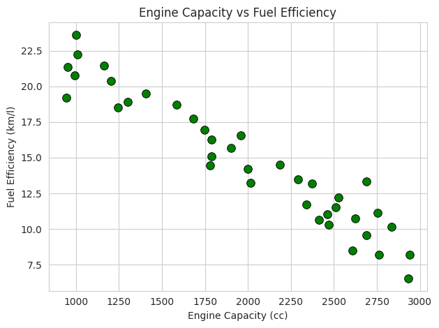

# 🚗 Vehicle Performance Analysis Using Python & Seaborn

## 📌 Project Overview

This project analyzes vehicle performance by examining the relationship between engine capacity and fuel efficiency using Python and data visualization techniques.

A scatter plot is used to visualize how fuel efficiency changes with engine capacity.

## 🎯 Objectives

- Analyze vehicle engine capacities.
- Study the relationship between engine capacity and fuel efficiency.
- Visualize data using scatter plots.
- Practice data analysis and visualization using Python.

## 🛠️ Technologies Used

- Python
- NumPy
- Pandas
- Matplotlib
- Seaborn
- Google Colab

## 📂 Project Structure

```text
Vehicle-Performance-Analysis/
│
├── Vehicle_Performance.ipynb
├── vehicle_data.csv
├── scatter_plot.png
└── README.md
```

## 📊 Dataset Information

The dataset contains:

| Column | Description |
|---|---|
| Engine Capacity (cc) | Vehicle engine capacity |
| Fuel Efficiency (km/l) | Fuel efficiency of the vehicle |

**Note:** The dataset is an approximate reconstruction from a reference graph for educational purposes.

## ⚙️ Installation and Execution

Clone the repository:

```bash
git clone https://github.com/karanbagade236-sketch/Vehicle-Performance-Analysis.git
```

Install the required libraries:

```bash
pip install numpy pandas matplotlib seaborn
```

Open the notebook in Jupyter or Google Colab, upload `vehicle_data.csv`, and run the cells.

## 📈 Project Output

The project generates a scatter plot titled:

**Engine Capacity vs Fuel Efficiency**

The visualization shows the relationship between engine capacity and fuel efficiency.



## 💡 Key Learning Outcomes

- Reading CSV datasets using Pandas.
- Understanding NumPy and random data generation.
- Creating scatter plots using Seaborn.
- Customizing graph titles, labels and markers.
- Visualizing relationships between variables.

## 👨‍💻 Author

**Karan N B**

Computer Science and Engineering Student

## 📜 License

This project is intended for educational purposes.
